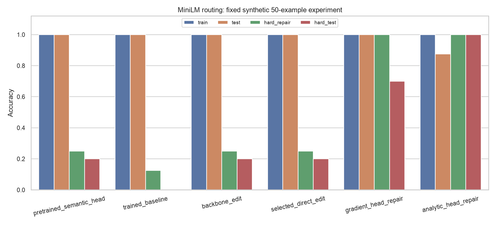

# Spaced Program Experiment

**Can direct weight edits fix a small language encoder that learned a routing shortcut?**

A compute-light, paper-inspired experiment using MiniLM and 50 synthetic support tickets. The trained model gets every ordinary test ticket right, but fails every hard-test ticket when archived routing metadata becomes misleading. We compare direct tensor edits with gradient-based and closed-form supervised repairs.

**Measured outcome:** the paper-inspired edits improve hard-test accuracy from **0/10 to 2/10**. A separate closed-form supervised head repair reaches **10/10**, while ordinary-test accuracy drops from **8/8 to 7/8**. That stronger result uses labeled repair examples and supervised fitting; it does **not** reproduce the paper's no-fitting result.

[Executed notebook](minilm_weight_space_research.ipynb) · [Results report](RESULTS.md) · [Fixed protocol](PROTOCOL.md) · [All metrics](results/metrics.csv) · [Every prediction](results/predictions.csv)

## Results

All methods use the same fixed examples. `hard_repair` is development data used for repair and selection; `hard_test` is reserved for final evaluation.

| Method | Train (24) | Ordinary test (8) | Hard repair (8) | Hard test (10) |
|---|---:|---:|---:|---:|
| Pretrained MiniLM + semantic head | 24/24 (100%) | 8/8 (100%) | 2/8 (25%) | 2/10 (20%) |
| Fine-tuned baseline | 24/24 (100%) | 8/8 (100%) | 1/8 (12.5%) | 0/10 (0%) |
| Backbone direction removal | 24/24 (100%) | 8/8 (100%) | 2/8 (25%) | 2/10 (20%) |
| Selected direct edit | 24/24 (100%) | 8/8 (100%) | 2/8 (25%) | 2/10 (20%) |
| Gradient head repair | 24/24 (100%) | 8/8 (100%) | 8/8 (100%) | 7/10 (70%) |
| Analytic supervised head repair | 24/24 (100%) | 7/8 (87.5%) | 8/8 (100%) | 10/10 (100%) |



Selected hard-test metrics, from the saved predictions:

| Method | Accuracy, Wilson 95% CI | Macro F1 | MCC | ROC-AUC | Log loss |
|---|---:|---:|---:|---:|---:|
| Fine-tuned baseline | 0%, [0.0%, 27.8%] | 0.000 | -1.000 | 0.000 | 0.982 |
| Backbone direction removal | 20%, [5.7%, 51.0%] | 0.167 | -0.655 | 0.200 | 0.744 |
| Selected direct edit | 20%, [5.7%, 51.0%] | 0.200 | -0.600 | 0.120 | 1.259 |
| Gradient head repair | 70%, [39.7%, 89.2%] | 0.670 | 0.500 | 0.840 | 0.580 |
| Analytic supervised head repair | 100%, [72.2%, 100%] | 1.000 | 1.000 | 1.000 | 0.223 |

The direct edits remain below the 50% balanced random-guessing reference on the hard test. Their small accuracy gain does not establish reliable repair, and the selected head edit worsens hard-test log loss. The analytic result is promising for this constructed shift, with a measurable ordinary-test regression. The pretrained semantic-head control already gets 20% on the hard test, so the selected direct edit does not exceed that control's hard-test accuracy.

[Full metrics](results/metrics.csv) also include balanced accuracy, per-class/macro/weighted precision, recall and F1, average precision, Brier score and ten-bin ECE. Probabilities are not calibrated. [Paired exact McNemar comparisons](results/paired_hard_test.csv) are exploratory, with no multiple-comparison adjustment.

## Task and split design

Route the customer's **current actionable request** to one of two classes:

- **Billing (0):** payments, refunds, invoices, subscriptions and receipts.
- **Account access (1):** login, passwords, account recovery and authentication.

Ignore archived routing metadata, resolved issues and explicitly denied requests.

There are **50 examples total**, rather than 50 training examples:

| Split | Examples | Role |
|---|---:|---|
| `train` | 24 | Initial supervised training; also retention anchors for repair |
| `test` | 8 | Ordinary final evaluation |
| `hard_repair` | 8 | Failure diagnosis, direct-edit selection and supervised repair |
| `hard_test` | 10 | Held-out final evaluation |

Every split is class-balanced. During training and ordinary testing, archived metadata agrees with the current request. On both hard splits, the metadata points to the opposite class. Hard tickets additionally negate or resolve competing intents.

For example, this request belongs to **account access**:

> The invoice is correct and no refund is needed. I only need my password reset.

Its archived metadata instead describes the billing department. The experiment deliberately creates a severe shortcut reversal; it is not a sample of real production tickets.

The dataset is committed in [data/tickets.json](data/tickets.json), with a [SHA-256 checksum](data/SHA256.txt). All text is visible to the project author, so the holdout is procedural rather than blinded. Both hard splits share construction patterns. The final tests do not participate in the implemented selection rule.

## Methods

### 1. Initial model and fine-tuning

Use [`sentence-transformers/all-MiniLM-L6-v2`](https://huggingface.co/sentence-transformers/all-MiniLM-L6-v2), pinned to revision `c9745ed1d9f207416be6d2e6f8de32d1f16199bf`. Attention-mask mean pooling and L2 normalization produce 384-dimensional features, followed by a linear two-class head.

Freeze embeddings and the first five transformer blocks. Train the final block and classifier for eight epochs, using only the 24 training examples. There is no test-driven early stopping.

### 2. Direct tensor edits

A fixed diagnostic program tests the hypothesis that archived metadata has become an unwanted shortcut. Four neutral requests are encoded twice, swapping only the archived routing header. The normalized mean feature difference defines a nuisance direction `u`.

Backbone candidates remove that direction from the final transformer's attention and FFN output matrices and biases:

```text
W_new = W - alpha * u (u^T W)
b_new = b - alpha * u (u^T b)
alpha in {0.5, 1.0}
```

This approximates a residual-stream intervention using pooled activation contrasts. LayerNorm remains in place, so the operation does not guarantee removal of the direction from final activations.

A separate candidate family replaces the classifier with a semantic-prototype head built from eight authored current-request probes, optionally removing its nuisance component at strengths `0`, `0.5` or `1.0`. These probes are additional semantic supervision.

There are six candidates including no edit. Selection maximizes hard-repair accuracy while allowing no more than a **1/24** training-accuracy drop; ties favor training accuracy, then fewer changed parameters. Neither final test split is consulted. The selected candidate is `semantic_head_0.5`, changing **770 of 22,713,986 parameters** (about **0.00339%**). The separately selected backbone intervention is `backbone_projection_1.0`.

[All candidate scores](results/edit_candidates.csv), including rejected candidates, and [diagnostic probes](results/diagnostic_probes.json) are retained.

### 3. Gradient repair control

Cache the fine-tuned encoder's features. Train only the 770-parameter classifier on the combined 24 train and 8 hard-repair examples for 100 small AdamW steps, with learning rate `0.03`. The encoder remains fixed.

### 4. Analytic supervised repair control

Fit a regularized residual correction to the classifier weights using the same cached train and hard-repair features. Preserve baseline logits on train examples; assign correct-class margin `3` on repair examples. Ridge regularization is fixed at `0.01`, and the dual solve is only **32 × 32**.

With bias appended to the features, the correction is:

```text
Z       = [normalized_features, 1]
R       = desired_logits - Z @ old_head.T
new_head = old_head + (Z.T @ solve(Z @ Z.T + 0.01 * I, R)).T
```

This changes 770 classifier parameters. It requires no backward pass, but it **is supervised fitting**. It is therefore a comparison method outside the paper's no-fitting rule.

## Relationship to the paper

Inspired by [Sparks of Weight-Space Programming](https://rikiyat.github.io/blog/weight-space-programming/) and its [released Experiment 8 protocol](https://github.com/RikiyaT/lm_understand-logs/tree/main/exp8_math).

The backbone projection uses the paper's direction-removal form. This project does not reproduce its frontier-LLM editing experiment: there is no separate editor-model call, and the fixed program uses activation probes. The paper's Experiment 8 also prohibited output-layer edits and iterative fitting; this project's semantic-head and supervised-head methods differ from those constraints.

The experiment tests whether these explicit interventions help this classifier. It does not demonstrate autonomous understanding of raw model weights or acquisition of general negation reasoning.

## Compute budget

The recorded run used **Apple Silicon MPS** and one seed (`42`). Metrics and small linear-algebra operations use CPU.

| Setting or measured stage | Value |
|---|---:|
| Total parameters | 22,713,986 |
| Initially trainable parameters | 1,775,234 |
| Epochs / batch size / maximum tokens | 8 / 8 / 96 |
| Final-block learning rate | 0.00002 |
| Initial head learning rate | 0.003 |
| Initial fine-tuning | 2.64 s |
| Direct-edit construction and selection stage | 0.49 s |
| Gradient head optimization, cached features | 0.18 s |
| Analytic head solve, cached features | 0.015 s |
| Recorded experiment elapsed time, including startup/download | 61.11 s |

These are one-machine measurements, not performance benchmarks. The direct-edit stage timing excludes earlier diagnostic/prototype feature extraction; supervised-control timings exclude feature caching. They are not matched end-to-end compute comparisons. Dependency installation is excluded. See [run metadata](results/run_metadata.json) for the environment and recorded timing fields.

## Run locally

Requires Python 3.12 and [uv](https://docs.astral.sh/uv/). MPS is used when available; otherwise the device is explicitly recorded as CPU. No paid API, editor-model call or API key is required.

```sh
git clone https://github.com/bolbolamir/spaced-program-experiment.git
cd spaced-program-experiment
./setup.sh
```

Inspect the saved results without training:

```sh
./Open_Notebook.command
```

The notebook defaults to `RUN_EXPERIMENT = False`. To repeat the experiment, set it to `True` and run all cells, or run:

```sh
.venv/bin/python experiment.py
```

The first run downloads the pinned MiniLM model (approximately 90 MB). Generated checkpoints, the model cache and the local environment are excluded from Git. The committed notebook and result files can be inspected without those checkpoints. Rerunning overwrites the local results; preserve a copy if comparing runs. MPS/kernel differences can affect repeatability, despite the fixed seed and pinned model.

After running the experiment, verify the artifacts and classify tickets with saved weights:

```sh
.venv/bin/python verify_artifacts.py
.venv/bin/python predict_ticket.py 'Please refund the duplicate charge.' --baseline
.venv/bin/python predict_ticket.py 'Please reset my password.' --method direct
.venv/bin/python predict_ticket.py 'Please reset my password.' --method gradient
.venv/bin/python predict_ticket.py 'Please reset my password.' --method analytic
```

Inference reconstructs the model locally from generated checkpoints and does not retrain it. The default inference variant is the selected direct edit; use `--method analytic` explicitly for the supervised analytic repair.

## Files and verification

| File or folder | Contents |
|---|---|
| [minilm_weight_space_research.ipynb](minilm_weight_space_research.ipynb) | Executed notebook, complete experiment code and saved displays |
| [experiment.py](experiment.py) | Training, candidate construction/selection, controls and final evaluation |
| [PROTOCOL.md](PROTOCOL.md) | Fixed design, budgets, acceptance rule and boundaries |
| [RESULTS.md](RESULTS.md) | Concise measured results |
| [data/](data/) | All 50 labeled synthetic tickets and dataset checksum |
| [results/](results/) | Metrics, every prediction, confusion matrices, candidate scores, parameter audits, runtime and plots |
| [verify_artifacts.py](verify_artifacts.py) | Metric/data consistency and exact checkpoint replay checks |
| [requirements.lock.txt](requirements.lock.txt) | Exact installed dependency versions |
| [create_dataset.py](create_dataset.py) | Rebuild the fixed authored dataset |
| [build_notebook.py](build_notebook.py) | Rebuild notebook cells; regenerating it clears saved execution outputs |
| `checkpoints/` (generated, ignored) | Baseline weights, exact edited tensors and additive patches |

The recorded [verification](results/verification.json) passed dataset size/ID/hash checks, recomputation of every reported accuracy, split membership checks, probability normalization, saved-delta checks and offline checkpoint replay. All ten selected-direct-edit hard-test probabilities matched exactly. The notebook executed without cell errors. The committed verification is a record of the original local run; a fresh clone must generate checkpoints before rerunning the full verifier.

## Limits and interpretation

- **Ten hard-test examples:** one prediction changes accuracy by ten percentage points. Even 10/10 has a Wilson 95% lower bound of about 72.2% under an independent-sample interpretation.
- **Synthetic, correlated examples:** the hard splits share construction patterns and were authored together. The benchmark is designed to expose a particular shortcut; it does not estimate real-world routing accuracy.
- **Single seed:** training variability is not measured.
- **Additional supervision:** class probes and labeled repair examples carry information unavailable to the initial training-only baseline. Gradient-free repair is not data-free repair.
- **Different methods and budgets:** backbone edits, head replacement, gradient fitting and closed-form fitting should not be treated as equivalent reproductions or equal-compute competitors.
- **Regression matters:** the strongest hard-test result loses one ordinary-test example. The selected direct edit changes confidence adversely even when its hard-test accuracy improves.

The next useful test is a larger, independently authored hard set with mixed metadata reliability, varied request structure and real tickets, followed by repeated seeds and matched-budget repair comparisons. The current experiment supports a narrow conclusion: direct edits offer limited help here, while supervised analytic head repair can correct this constructed shift at a small ordinary-test cost.

## References and attribution

- Rikiya Takehi, Jayden Teoh, Alex Zhang and Omar Khattab. [Sparks of Weight-Space Programming](https://rikiyat.github.io/blog/weight-space-programming/), November 2026.
- [Released experiment logs and code](https://github.com/RikiyaT/lm_understand-logs), particularly Experiment 8.
- [MiniLM checkpoint and model card](https://huggingface.co/sentence-transformers/all-MiniLM-L6-v2), Apache-2.0.

The copied [Experiment 8 README](paper_reference/experiment8_README.md) is attributed to the upstream authors and was accessed on 2026-11-06. The upstream repository identifies scripts as MIT and logs/data/networks as CC BY 4.0. Third-party material retains its upstream terms. This project does not redistribute the pretrained MiniLM weights or the paper's Qwen edits.
