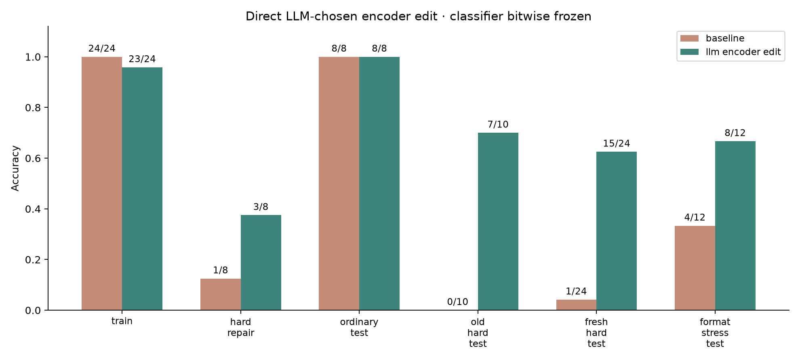

# Direct LLM-chosen encoder edits

This follow-up keeps the classifier bitwise frozen. Codex, acting interactively in the chat, inspected failures, concise rationales, token positions, attention patterns and weight/activation statistics, then authored four explicit encoder patches. No gradient optimization or supervised residual fitting was used during repair. It is an example of tool-assisted weight-space programming, with a narrow synthetic task and a format-specific selected edit.

## Measured results

| Split | Baseline | Selected encoder edit |
|---|---:|---:|
| Train | 24/24 | 23/24 |
| Hard repair (development) | 1/8 | 3/8 |
| Ordinary test (previously seen) | 8/8 | 8/8 |
| Old hard test (previously seen) | 0/10 | 7/10 |
| Fresh hard test | 1/24 | 15/24 |
| Varied-format stress test | 4/12 | 8/12 |

The selected edit changes 6,912 of 22,713,986 parameters (about 0.0304%), all in the positional embedding table. It replaces positional rows 1..18 with eight times the pretrained SEP embedding. The intent is to attenuate archived header-token identity through the embedding LayerNorm, while leaving the current request's positions untouched in the original input schema. Tokenization, masks, pooling, classifier weights and classifier bias remain unchanged. On the format-stress set it fixes seven baseline mistakes but also breaks three previously correct answers; the net improvement does not eliminate format-related regressions.

This is a positional, format-dependent intervention. It does not demonstrate general negation reasoning, and it is not a reproduction of Experiment 8's allowed-tensor restrictions: that experiment prohibited embedding edits. Varied-format results are included because requests that begin earlier can be damaged by this patch.



## Recorded editor decisions

1. **Inspect the failure.** Full-context repair accuracy was 1/8; request-only variants reached only 3/8. The problem includes both misleading metadata and competition between resolved and active intents.
2. **Disable last-block attention head 7.** It had relatively high request-to-header attention. Repair stayed at 1/8, so this attribution hypothesis did not translate into a useful isolated intervention.
3. **Neutralize header positions.** Token inspection placed archived metadata at positions 1..17 or 1..18; the current request began at 22 or 23. The positional patch reached 3/8 repair while retaining 23/24 train examples.
4. **Disable FFN output column 77.** Its activation/write statistics suggested a possible misleading contribution. Repair stayed at 1/8. These statistics do not establish semantic feature identities.
5. **Combine position neutralization with early attention-head ablation.** Repair and train counts matched the positional patch, with more changed parameters. The fixed tie-break selected the smaller positional patch.

The candidate family was not executed as a prewritten sweep. Each next edit was authored in the chat after observing preceding diagnostics/results. `editor_steps.py` preserves those patches and concise decision summaries. The notebook and `replay.py` replay this recorded sequence; they make **no new editor-LLM calls** and do not autonomously rediscover the edits. The editor is the assistant in the chat, not a separately invoked Astra model. No hidden reasoning trace is included or required.

## Notebook and replay

Open the extra notebook at the repository root:

```sh
.venv/bin/jupyter lab direct_encoder_weight_editing.ipynb
```

It defaults to viewing saved results. To replay, first generate the original baseline checkpoint if absent:

```sh
.venv/bin/python experiment.py
.venv/bin/python -m direct_weight_editing.replay
```

If the original baseline already exists locally, skip the first command. The repair replay uses MPS if available and records CPU fallback explicitly. Every replay creates an ignored directory under `direct_weight_editing/runs/`, preserving the published results. It reuses the fixed patches and selection rule. If baseline weights or numerical kernels differ, metrics may differ; this is not a fresh adaptive editing session.

Original full checkpoints remain local and ignored. `results/selected_patch.npz` stores just the changed values and indices in a non-pickle compact patch. `results/weight_changes.csv` gives before/after tensor hashes. The recorded baseline hash binds the patch and predictions to the original baseline.

Verify the original saved run (requires its local baseline checkpoint):

```sh
.venv/bin/python -m direct_weight_editing.verify
```

## Evaluation boundaries

The original train and eight repair cases plus their request-only variants were the only model-feedback examples during editing. Four nonbaseline candidates were allowed. The choice maximized repair accuracy subject to train >=23/24, then favored training accuracy, fewer changed values and the earlier candidate.

The fresh 24-case hard test and 12-case format-stress set were created and hashed before diagnostics, and scored only after `final_selection.json` was saved. They were authored by the same agent, so they are a **procedural holdout, not an independent or blinded benchmark**. The old tests were already inspected in the earlier experiment. All final outcomes are retained without post-evaluation candidate changes.

One seed, tiny synthetic sets, shared construction patterns and positional assumptions limit generalization. See [the full report](RESULTS.md), [all metrics](results/metrics.csv), [every prediction](results/predictions.csv), [candidate history](results/candidate_log.json), [protocol](PROTOCOL.md) and [verification](results/artifact_checks.json).

Candidate assessments, including loading the baseline each time, took about 9.9 seconds total. Final evaluation including loading took about 2.3 seconds. These exclude LLM deliberation, diagnostic runs and notebook packaging, and are not end-to-end timing benchmarks. No new dependencies or paid API calls were needed.
